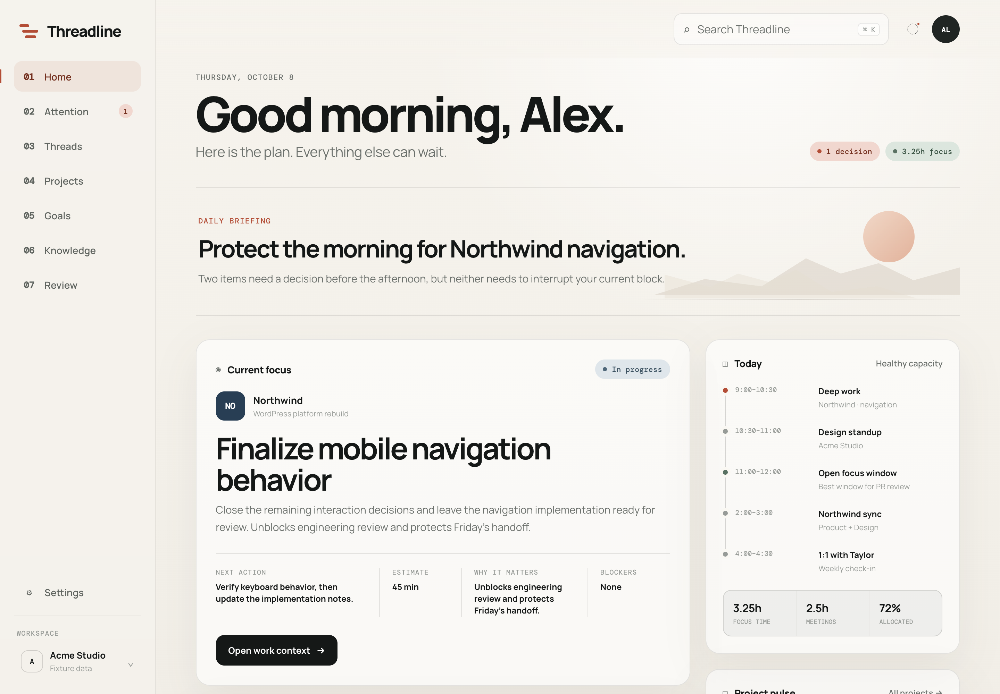
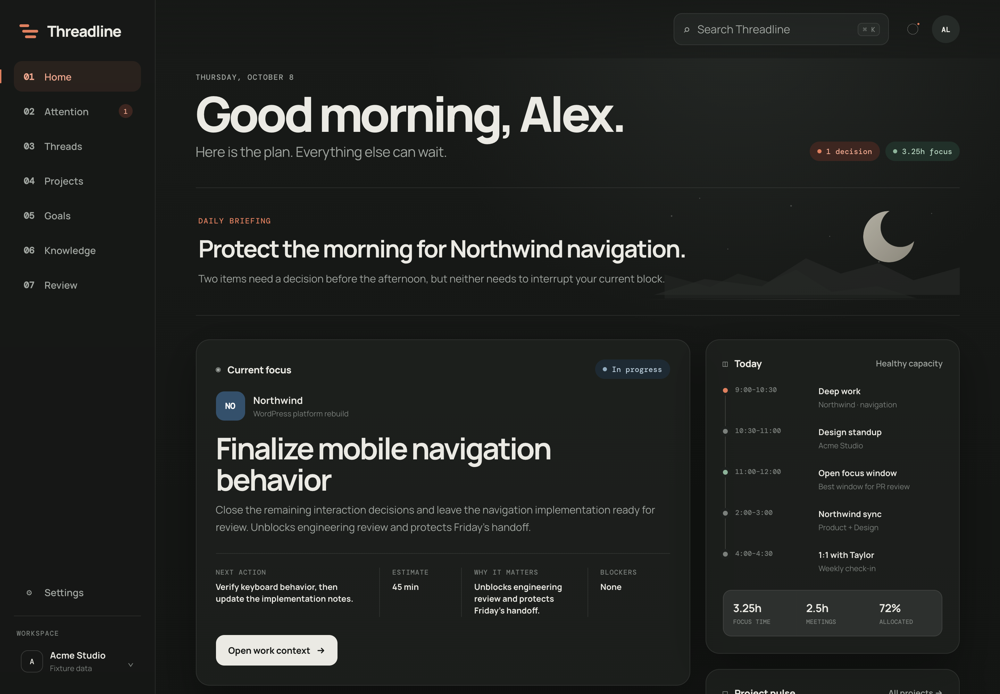
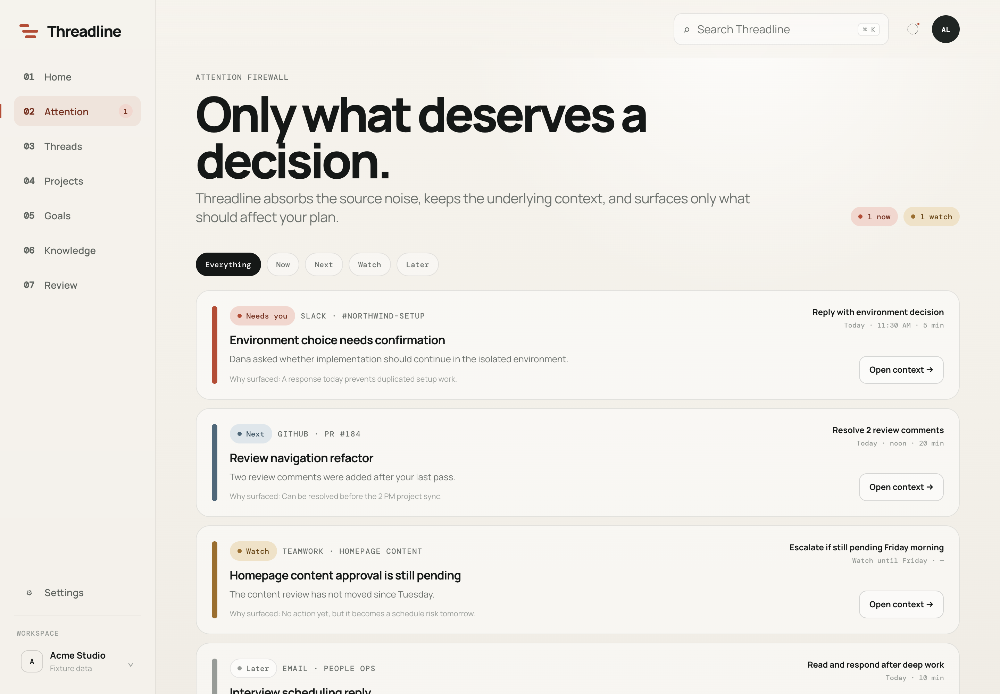
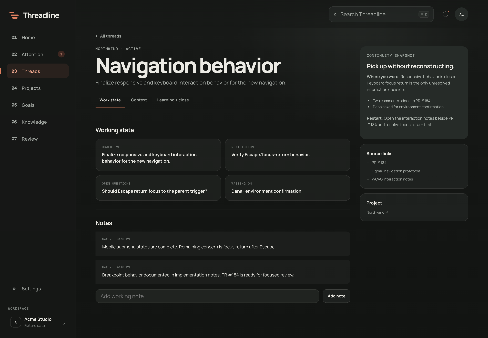

# Threadline prototype

Threadline is a calm work dashboard. It reads from the tools where work happens and shows what matters now.

Threadline is read-only toward every source. It reads, links, and points back. It never changes anything in Teamwork, GitHub, Calendar, Malcolm, Leapsome, or Relay Cloud. What you confirm in Threadline, such as to-dos and the work journal, stays in Threadline's local storage.

This prototype has two parts:

- A static UI (`index.html`, `app.js`, `styles.css`) with no build step.
- A sync command that pulls live data from Teamwork, Google Calendar, and GitHub. It writes `data/state.json` for the UI.

Without a sync, the UI renders a fixture. Every source is optional.



<table>
  <tr>
    <td></td>
    <td></td>
  </tr>
  <tr>
    <td></td>
    <td valign="top">All screenshots show the demo fixture in <code>fixtures/normal-day.json</code>. The names and data are made up.</td>
  </tr>
</table>

See [CHANGELOG.md](CHANGELOG.md) for what changed in each version.

## Contents

1. [Quick start](#quick-start)
2. [Requirements](#requirements)
3. [Setup](#setup)
   - [Install](#install)
   - [The `.env` file](#the-env-file)
   - [Connect Teamwork](#connect-teamwork)
   - [Connect Google Calendar](#connect-google-calendar)
   - [Connect GitHub](#connect-github)
   - [GitLab and other hosts](#gitlab-and-other-hosts)
   - [Time zone](#time-zone)
4. [Configuration reference](#configuration-reference)
5. [Commands](#commands)
6. [Files: what is secret, what is generated](#files-what-is-secret-what-is-generated)
7. [Troubleshooting](#troubleshooting)
8. [Architecture](#architecture)
9. [Not built yet](#not-built-yet)

## Quick start

```bash
nvm use                  # if you use nvm; switches to the Node version in .nvmrc
npm install
cp .env.example .env                                   # secrets: fill in the sources you use
cp threadline.config.example.json threadline.config.json  # settings: edit for your setup
npm run auth:google      # once, if you use Google Calendar
npm start                # open http://localhost:8080
```

`npm start` syncs right away, then every 15 minutes while it runs. Open pages update by themselves. Leave the terminal open, and press `Ctrl+C` to stop.

## Requirements

| Tool | Version | Used for |
| --- | --- | --- |
| Node.js | 22.18 or later | Runs the TypeScript sync code directly, with no build step. With nvm, run `nvm install` once in this folder, then `nvm use` in each new terminal. The version is in `.nvmrc`. |
| GitHub CLI (`gh`) | 2.40 or later | Optional. Lets GitHub use your existing `gh` login. |

## Setup

### Install

```bash
npm install
```

The only runtime dependency is `zod`. `typescript` and `@types/node` are dev dependencies for `npm run typecheck`.

### The `.env` file

Secrets live in `.env`, which is git-ignored. Settings that are not secret live in `threadline.config.json`.

```bash
cp .env.example .env
cp threadline.config.example.json threadline.config.json
```

Both copies are git-ignored, so your secrets and your project names stay out of the repository.

| Variable | Source | Required when |
| --- | --- | --- |
| `TEAMWORK_API_KEY` | Teamwork | You want Teamwork tasks and projects. |
| `GOOGLE_CLIENT_ID` | Google Calendar | You want the calendar. |
| `GOOGLE_CLIENT_SECRET` | Google Calendar | You want the calendar. |
| `RELAY_API_KEY` | Relay Cloud | You want PRD context on your tasks. |
| `MALCOLM_EMAIL` | Malcolm | Optional. Used when `malcolm.email` is not set in the config. |
| Any name you choose, such as `GITHUB_TOKEN_CLIENT` | GitHub | A `codeHosts` connection uses `"auth": { "env": "<name>" }`. |

If a variable is missing, the sync skips that source and says so. It does not fail.

### Connect Teamwork

1. In Teamwork, open your profile avatar, then go to **Edit profile → API & Mobile**.
2. Copy your API token into `.env` as `TEAMWORK_API_KEY`.
3. Set `teamwork.site` in `threadline.config.json` to your Teamwork URL, such as `https://your-company.teamwork.com`.
4. Run `npm run sync`.

**What it reads:** open tasks assigned to you, and tasks you completed in the last 30 days.

**What becomes a project:** only Teamwork projects where you have tasks. Project membership alone does not count.

**Board stages:** Threadline reads each task's workflow stage, the board column such as "In Review", and shows that name on cards. The stage also sets the task's status:

| Stage name contains | Status | Effect |
| --- | --- | --- |
| needs attn, needs feedback, feedback shared, changes requested | Needs your response | Raises a NEXT item. |
| blocked, on hold, paused | Blocked | Leaves your focus and Next up. |
| done, complete, closed, deployed | Done | Leaves your open work. |
| review, QA, testing, approved | Waiting on others | Leaves your focus, Next up, and today's capacity. |
| in progress, doing, started | In progress | |
| to do, planned, backlog, discovery, ready to start | Open | |

Completion in Teamwork always wins. A task with no stage, or a stage no rule matches, falls back to its progress percentage. The sync lists unmatched stage names. To map one, or to correct a rule, add it to `teamwork.stageStatus`:

```json
"stageStatus": { "Icebox": "blocked", "In Client QA": "needs_response" }
```

The values are `open`, `in_progress`, `blocked`, `waiting`, `done`, and `needs_response`. Names match without regard to case.

**Project names:** `teamwork.projects` maps a Teamwork project id to a stable Threadline id and a short name. An unmapped project gets the id `tw-<number>`, and its name is the Teamwork title up to the first " - " or "(". To find a project's id, open it in Teamwork and look at the URL: `/app/projects/<id>`.

### Connect Google Calendar

Google needs an OAuth client that you create once.

1. Open the [Google Cloud console](https://console.cloud.google.com/). Create a project, or pick one you own.
2. Go to **APIs & Services → Library**. Enable the **Google Calendar API**.
3. Go to **APIs & Services → OAuth consent screen**. Choose **Internal** if your Workspace allows it. Otherwise choose **External** and add yourself as a test user.
4. Go to **APIs & Services → Credentials → Create credentials → OAuth client ID**. Choose the application type **Desktop app**.
5. Copy the client ID and secret into `.env` as `GOOGLE_CLIENT_ID` and `GOOGLE_CLIENT_SECRET`.
6. Run `npm run auth:google`. A browser window opens. Sign in and approve read-only calendar access.
7. Run `npm run sync`.

**What sign-in stores:** a refresh token in `.threadline/google-token.json`, with file mode 600. Delete that file to disconnect. You can also revoke access at [myaccount.google.com/permissions](https://myaccount.google.com/permissions).

**Scope:** `calendar.events.readonly`. Threadline cannot change your calendar.

**What it reads:** events from today through the next 7 days, on the calendars in `calendar.calendarIds`. The default is `primary`. Threadline ignores declined events, cancelled events, and working-location events.

**What it derives:** today's schedule, open focus windows, meeting hours, overlapping meetings, and capacity for the week. Focus windows are free blocks of 30 minutes or more inside your workday hours.

> Your Workspace admin may block OAuth clients that the admin did not approve. If sign-in fails with "access blocked", ask the admin. You can also wait for the iCal adapter, which is not built yet.

### Connect GitHub

Many people have work and personal repos under one account, and work repos spread across several orgs or accounts. Threadline handles this with **explicit allowlists**. Each connection lists the repos that count as work and maps each one to a project. It ignores everything else.

#### 1. Pick how each connection authenticates

**Option A: GitHub CLI login (recommended).** No token goes in `.env`.

```bash
gh auth login                     # once per account
gh auth status                    # lists every logged-in account
```

```json
"auth": { "gh": { "user": "octocat" } }
```

`user` selects one account when you are logged in to more than one. If you leave it out, Threadline uses the active account.

**Option B: a personal access token in `.env`.** Use this for an account you do not keep logged in to `gh`.

```json
"auth": { "env": "GITHUB_TOKEN_CLIENT" }
```

```bash
# .env
GITHUB_TOKEN_CLIENT=ghp_...
```

Use a **classic** token with the scopes `repo` and `read:org`. A fine-grained token only covers one owner, such as one org. That works only if all the repos in the connection belong to that owner. For a fine-grained token, grant read access to **Pull requests**, **Issues**, and **Metadata**.

#### 2. List the work repos

```json
"codeHosts": [
  {
    "id": "github-work",
    "type": "github",
    "host": "github.com",
    "auth": { "gh": { "user": "octocat" } },
    "repos": {
      "acme/northwind-website": "northwind",
      "acme/juniper-*": "juniper",
      "acme-internal/*": null
    }
  }
]
```

- The key is `owner/repo`. Use `*` as a wildcard: `owner/*` matches every repo under an owner, and `owner/site-*` matches repos whose names start with `site-`. An exact name wins. Otherwise the longest matching pattern wins.
- The value is a Threadline project id. Use the same id as in `teamwork.projects`, such as `"northwind"`, so GitHub and Teamwork work land in one project. Use `null` for work that belongs to no project.
- An unlisted repo is ignored. Its items are never stored. After each sync, the terminal lists the repos it ignored, so you can add the ones that are work:

  ```text
  · github-work ignored repos not in its allowlist: octocat/dotfiles, octocat/personal-site
  ```

#### 3. Add more accounts or hosts

Add one entry to `codeHosts` for each account. For GitHub Enterprise, set `host` to the server's hostname, such as `"github.example.com"`. If two connections see the same pull request, Threadline keeps the first copy.

#### What GitHub contributes

| Item | Becomes | Attention rule |
| --- | --- | --- |
| A review requested from you | A work item: "Review: <title>" | NEXT. A teammate is waiting. |
| Your PR with failing checks | A work item | NEXT. |
| Your PR with changes requested | A work item | NEXT. |
| Your PR that is approved | A work item | NEXT. Ready to merge. |
| Your PR waiting for review | A waiting item, kept out of your focus | WATCH after 3 days with no activity. |
| Your PR or review idle for 30 days or more | Treated as abandoned | No signal. |
| An issue assigned to you | A work item. Its due date is the milestone's due date. | Same rules as tasks. |

### Connect Relay Cloud

Relay Cloud holds the project's PRDs. Threadline links each task to the PRD written for it and shows that PRD's status, acceptance criteria, open questions, needed dependencies, and design link on the focus card.

1. Create a Relay API key in Relay Cloud.
2. Add it to `.env` as `RELAY_API_KEY`.
3. Set your Relay Cloud endpoint and link patterns, and map Threadline projects to Relay project slugs, in `threadline.config.json`:

   ```json
   "relay": {
     "url": "https://relay.example.com/api/mcp",
     "projectUrl": "https://relay.example.com/projects/{project}",
     "documentUrl": "https://relay.example.com/projects/{project}/docs/{path}",
     "projects": { "northwind": ["northwind-site"], "juniper": ["juniper-redesign", "juniper"] }
   }
   ```

   A project can map to several slugs, such as a redesign and its parent project.
4. Run `npm run sync`.

Threadline calls the Relay Cloud MCP server at `relay.url` directly, with the API key as a bearer token. It does not need Claude. It reads only the PRDs whose content changed since the last sync, and keeps the rest in `data/relay-cache.json`.

**How tasks link to PRDs**, in order:

1. A Teamwork task URL inside the PRD. Relay PRDs record the task they were written for in their Implementation History. URLs in the Dependencies table are skipped, because they name related tasks.
2. A PRD code such as `PRD-03.2.01` in the task title.

**The rule it adds:** work that is in progress, or due within 5 days, whose PRD still has open questions raises a NEXT item, "Footer: 4 open product questions". Building before those answers risks rework.

### Connect Malcolm

Malcolm holds your project bookings (allocations) and your leave. Threadline compares this week's booked hours per project with the hours you logged in Teamwork.

Malcolm has no personal API token yet. Until it does, Threadline asks Claude Code to read Malcolm through the Malcolm connector:

1. Make sure the `claude` CLI is installed and logged in, and that the Malcolm connector works in Claude.
2. In `threadline.config.json`, set `malcolm.enabled` to `true` and `malcolm.email` to your Malcolm login.
3. Run `npm run import:malcolm`. It takes about 20 seconds and costs one or two cents with the default Haiku model.
4. Run `npm run sync`.

`npm start` repeats the import when it is older than `malcolm.maxAgeHours`, 12 by default.

The import is strict about its output. Claude must return JSON that matches a fixed schema, and Threadline validates that JSON again before saving it to `data/imports/malcolm.json`. The file records which model produced it. When Malcolm offers an API token, an adapter can replace the import without changing anything downstream.

**What it adds:**

| Signal | Level |
| --- | --- |
| A project is behind its booked pace this week, such as "13.5 h of this week's booking left" | WATCH. NEXT when 2 or fewer working days are left and 4 h or more remain. It names the project manager. |
| A project is booked, but nothing open is assigned to you | WATCH. "Ask what to pick up." |
| You logged more than a project's booking | WATCH. |
| Your bookings add up to more than your working hours | WATCH. |

Ranking also shifts a little. When due dates tie, tasks on projects behind pace move up, and tasks on projects at or over their booking move down. Leave from Malcolm counts as a day off, the same as an all-day out-of-office event.

Logged hours come from Teamwork time logs, with your existing Teamwork token, so they stay current between Malcolm imports.

### Connect Leapsome

Leapsome holds your goals and key results. Threadline shows them on the **Goals** page, current cycle first, then past cycles as history.

Leapsome has no personal API token, so the import works like Malcolm's:

1. In Claude Code, run `/mcp` and connect **claude.ai Leapsome**.
2. Set `leapsome.enabled` to `true` in `threadline.config.json`.
3. Run `npm run import:leapsome`, then `npm run sync`. `npm start` repeats the import once a day.

Each goal shows its key results with their progress. The "Open in Leapsome" link goes to the Leapsome goals page, because Leapsome records carry no link to a single goal.

Both Claude-run imports share one helper, `src/adapters/claude-import.ts`. It gives Claude only the named read tools, asks for JSON that matches a fixed schema, and validates the result again with Zod.

### Show your Claude usage

Threadline can show how much of your Claude plan you have used. A **Claude usage** card on the home page, between Today and Project pulse, shows the 5-hour window and the week, each with a bar and its reset time. Settings shows the same reading. When the 5-hour window passes 80% or the week passes 85%, a WATCH item suggests saving big code tasks for after the reset.

Claude Code is the only source. After each reply, it passes the usage to its status line command. Point the status line at Threadline's script in `.claude/settings.local.json`, a git-ignored file that affects only Claude Code sessions in this folder:

```json
{
  "statusLine": {
    "type": "command",
    "command": "node \"/path/to/threadline/scripts/claude-statusline.cjs\""
  }
}
```

The script prints a short status line, such as "Opus · 5h 64% · week 74%". It saves only the two usage windows and the capture time to `data/claude-usage.json`. The rest of the status line input, which includes file paths, is not stored.

The reading updates only while a Claude Code session runs in this folder. A reading older than 3 hours stays on the card, marked "Last reported", and no longer raises the near-limit warning. A window whose reset time has passed is dropped. Claude Code's documentation describes this data for Pro and Max plans; it also works on a Team plan. A custom status line replaces most of Claude Code's footer hints.

### GitLab and other hosts

GitLab is not supported yet. The config and schema are ready for it. A GitLab connection will be another `codeHosts` entry with `"type": "gitlab"`. It will use the same `repos` allowlist and the same code review fields, so the attention rules will work unchanged. Until then, GitLab work shows up only through its Teamwork tasks.

### Time zone

Set `timezone` in `threadline.config.json` to your own IANA time zone, for example `"America/New_York"`. The sync uses it to decide what "today" is and where your workday starts and ends.

Teammates in other time zones need no setup. Google Calendar stores meetings as absolute times, and Threadline shows them in your zone. `workday` is always your own hours, in your zone.

If you leave `timezone` out, the sync uses the computer's zone. Setting it keeps results the same when you travel, or when the sync runs on a server.

## Configuration reference

`threadline.config.json`:

| Key | Default | Meaning |
| --- | --- | --- |
| `workspace` | — | Name shown in the sidebar. |
| `displayName` | First name from Teamwork | The name in the greeting. |
| `timezone` | System zone | IANA zone for "today" and workday hours. |
| `workday.start`, `workday.end` | — | Your working hours, `"HH:MM"`. Focus time and capacity use these. |
| `teamwork.site` | — | Your Teamwork URL. |
| `teamwork.completedLookbackDays` | `30` | How far back completed tasks count toward progress and weekly wins. |
| `teamwork.excludeProjectIds` | `[]` | Teamwork projects to ignore, such as internal time tracking. |
| `teamwork.projects` | `{}` | Teamwork project id → `{ "id", "name" }`. |
| `teamwork.stageStatus` | `{}` | Board stage name → status, for stages the built-in rules read wrong. See [Connect Teamwork](#connect-teamwork). |
| `calendar.calendarIds` | `["primary"]` | Google calendars to read. |
| `calendar.lookaheadDays` | `7` | How many days ahead to read. |
| `server.port` | `8080` | Port for `npm start` and `npm run serve`. The `PORT` environment variable overrides it. |
| `server.syncIntervalMinutes` | `15` | How often `npm start` syncs. |
| `relay.url` | — | The Relay Cloud MCP endpoint. Required to sync PRDs. |
| `relay.projects` | `{}` | Threadline project id → Relay project slugs. |
| `relay.projectUrl` | — | Link to a Relay project. `{project}` is the slug. |
| `relay.documentUrl` | — | Link to one Relay document. Unset links documents to their project. |
| `malcolm.enabled` | `false` | Turn the Malcolm import on. |
| `malcolm.email` | — | Your Malcolm login email. |
| `malcolm.maxAgeHours` | `12` | `npm start` re-imports when the last import is older. |
| `malcolm.model` | `haiku` | The Claude model that runs the import. |
| `leapsome.enabled` | `false` | Turn the Leapsome goal import on. |
| `leapsome.includeArchived` | `true` | Include goals from past cycles. |
| `leapsome.maxAgeHours` | `24` | `npm start` re-imports when the last import is older. |
| `leapsome.model` | `haiku` | The Claude model that runs the import. |
| `codeReview.agingDays` | `2` | Working days before a PR waiting for review counts as aging. |
| `codeReview.staleDays` | `4` | Working days before it needs a bump. |
| `batching.switchMinutes` | `[5, 15]` | Minutes lost per switch between tickets, low and high. |
| `batching.parallelSlots` | `3` | Tickets a parallel batch runs at once. |
| `report.days` | `7` | How many days the Report page covers, today included. |
| `continuity.awayHours` | `8` | How long a gap must be before "while you were away" appears. |
| `codeHosts[]` | `[]` | GitHub connections. See [Connect GitHub](#connect-github). |

`npm run check` validates this file.

## Commands

| Command | What it does |
| --- | --- |
| `npm start` | Serves the UI at `http://localhost:8080`, syncs at start, then syncs every `server.syncIntervalMinutes`. Open pages update in place. |
| `npm run sync -- --rebuild` | Rebuilds `data/state.json` from the last sync plus your to-dos, without fetching. The server runs this after every to-do change. |
| `npm run sync` | Fetches every configured source, then writes `data/state.json` for the UI and `data/entities.json` for debugging. It prints one line per source and the repos it ignored. It exits with an error only when no source succeeds. |
| `npm run import:malcolm` | Reads your Malcolm bookings and leave through Claude Code and saves them to `data/imports/malcolm.json`. |
| `npm run import:leapsome` | Reads your Leapsome goals through Claude Code and saves them to `data/imports/leapsome.json`. |
| `npm run auth:google` | One-time Google sign-in. Run it again if Google says the token expired or was revoked. |
| `npm run serve` | Serves the UI without automatic sync. |
| `npm run check` | Validates the config, every fixture, the memory file, and the last sync output against the schema. |
| `npm run typecheck` | Runs the TypeScript compiler without emitting files. |

### Choosing the data on screen

Open **Settings** at the bottom of the sidebar, then choose **Live** or a fixture under **Data source**. Threadline picks the data in this order:

1. A `?fixture=<name>` in the URL. Settings warns you when this is active and has a button to remove it.
2. The data source chosen in Settings.
3. Live data from `data/state.json`. If no sync has run, Threadline shows `fixtures/normal-day.json`, and Settings says so.

The workspace card at the bottom of the sidebar says "Fixture data" or "Live · <sync time>". Select it to open Settings, which lists each source's sync result.

Two fixtures ship with the project. `normal-day` is a typical weekday. `returning-after-weekend` is a Monday after time away, with to-dos and a "while you were away" card. To add a fixture, put the JSON file in `fixtures/` and add its name to `FIXTURES` in `loader.js`.

### Settings and theme

The Settings page holds per-browser preferences: the theme (System, Light, or Dark) and the data source. They are saved in this browser's local storage, so they do not sync across browsers or machines. System follows the operating system's light or dark mode and changes with it.

All colors in `styles.css` are tokens on `:root`. The dark theme is one block under `:root[data-theme="dark"]` that only overrides tokens. `theme.js` runs in `<head>` and sets `data-theme` before the page paints. To add a color, define it in both blocks.

## To-dos

Some work has no ticket: updating a local toolchain, rebuilding a database, a follow-up you promised in a meeting. Add it as a to-do.

- On the home page, select **+ Add to-do** in the Next up card. You can also open the **To-dos** page from that card.
- A to-do has a title, plus an optional project, due date, and estimate.
- To-dos rank with your Teamwork and GitHub work. They can become your current focus, they count toward today's capacity, and they get the same due-date and stale-date rules.
- Check one off in Next up, in the focus card, or on the To-dos page. Done to-dos stay on the To-dos page for 7 days, and they count toward the project's weekly wins.

To-dos live in `memory/todos.json`, which is git-ignored. Adding and editing needs `npm start`, because the page saves through the local server. With a fixture or a static server, the To-dos page is read-only.

## Work journal

Sources keep only recent history: 7 days of activity and 30 days of completions. The work journal keeps it permanently, so accomplishments, reflections, and goal evidence have a record to stand on.

On each sync, Threadline appends what you did to `memory/journal/YYYY-MM.jsonl`, one JSON line per entry:

| Entry | From |
| --- | --- |
| Comment | Your Teamwork comments, as a short note with the PR number when one is linked |
| Completed, reopened | Your Teamwork activity |
| Moved | A board stage change since the previous sync, such as "In Progress → In Review" |
| To-do done | Your Threadline to-dos |
| Time | Hours per project per day, written only once the day is over |

Each entry keeps a stable id from its source event, so a sync never writes the same entry twice. Entries are never edited or removed. The journal is git-ignored.

Each project page shows its recent entries under **Work record**.

## Knowledge base

Relay Cloud is the team's knowledge base for tickets. Each project page shows a read-only **Knowledge base** section for the project's Relay spaces:

- Document counts: PRDs, epics, and notebook pages.
- **PRDs in play:** drafts, approved PRDs, and any PRD linked to your work, with open questions.
- **Recent notebook pages**, such as decision logs and meeting notes.
- Links into Relay Cloud for each space and document.

Threadline indexes titles and statuses, and reads PRD bodies only to show acceptance criteria and open questions. It does not copy Relay content into its own memory, and it never writes to Relay.

Each document links straight to its page in Relay Cloud through `relay.documentUrl`, such as `https://relay.example.com/projects/{project}/docs/{path}`. `{path}` is the file path inside `requirements/`, without `/index.md` or `.md`. Without `relay.documentUrl`, documents link to their project page, and without `relay.projectUrl` there are no links.

## Threads

A thread is one piece of work followed across systems. The Threads page builds one for each Teamwork task you worked on in the last 21 days, and for each open pull request of yours that no task mentions. There is nothing to set up.

Each thread links:

- The Teamwork task and its board stage.
- Pull requests named in your comments, either as a full GitHub URL or as `owner/repo#123`, or titled exactly like the task. Each shows its current state: waiting for review, changes requested, approved, merged, or closed.
- The PRD linked to the task, with its open questions and design links.
- Hours you logged on the task this week.

From those, the thread works out:

| Field | How |
| --- | --- |
| Where you left off | Your last comment, plus the current stage |
| What changed since | Stage moves and pull request reviews after your last comment |
| Waiting on | A review stage, a pull request review, or the people the task was handed to |
| Next step | Requested changes, failing checks, feedback to answer, or an approved PR to merge. Otherwise "nothing for you" while it waits. |

Threads are grouped into **Needs you**, **Waiting on others**, and **Done**. A thread needs you whenever something on it is yours to act on, whatever the board stage says.

One rule raises a WATCH item: when every pull request on a task is merged but the task still sits in a review stage, the board no longer matches the work.

**Notes.** Each thread has working notes for what future you should know. They are saved in `memory/notes.json`, which is git-ignored, and they never leave Threadline.

## Code review queue

Tickets and code reviews are kept apart. A pull request of yours that is waiting for review is not an action for you, so it never appears in your focus, in Next up, or under "Needs you". Instead, the home page's **In code review** card and the Threads page's **In code review** group list your PRs with how long each has waited and who it waits on.

Waiting time counts working days since review was last requested, or since the PR opened. A PR is fresh at first, **aging** after `codeReview.agingDays` (2), and **needs a bump** after `codeReview.staleDays` (4). One WATCH item, such as "2 pull requests need a bump from reviewers", appears only when something is stale.

A merged PR whose ticket still sits in a review stage is noted on its thread, without being counted as your action. The reviewer usually moves that ticket.

## Batches

To cut ramp-up time, the home page suggests tickets worth doing together, under **Batches**. Tickets group by project, then by epic code (such as `E 5.x`), title prefix (such as `Core block:`), or tasklist.

| Kind | When | How to do it |
| --- | --- | --- |
| Parallel | Every ticket is ready (approved PRD, no open questions), and none share a PRD or depend on each other | Build them side by side, for example with AI agents in separate git worktrees, `batching.parallelSlots` at a time |
| Back to back | The tickets share context but share a PRD, depend on each other, or have unknown readiness | Do them in one focus block, so you ramp up once |

Each batch shows its estimate and the ramp-up it saves, using `batching.switchMinutes`, 5–15 minutes per switch by default. It also says whether it fits the project's booked hours this week, and holds parallel AI builds while Claude usage is at 90% or more. **Copy brief** gives plain text for any worktree or agent tool: the repo, each ticket with its link, PRD, and estimate, and how to run it.

Only your own actionable Teamwork work is batched. Waiting, blocked, and stale tickets are left out. Readiness relies on Relay PRDs, so projects without PRDs only get back-to-back batches.

## Daily report

The **Report** page writes your status update for you. For each day, it lists the work you moved, grouped by project:

> **Northwind**
> • **Navigation behavior** — In Review. Ready for a team check (PR #184)
> • **Homepage hero** — In Review. Ready for code review
> _Next:_ Footer · Quote block

Each line combines three things:

- **What you did**, from Teamwork's activity log: your comments, updates, and completions. A comment becomes its first line, without the task name, plus the PR number when the comment links a pull request.
- **Where the task is now**, from its board stage. When Threadline has a snapshot from the start of that day, the line shows the move, such as "In Progress → In Review".
- **Your finished to-dos** for that day.

For today, each project also lists what's next and what's waiting on others.

Tasks you hand off stay in the report. When you reassign a task to reviewers, it leaves your focus and Next up, because it is no longer yours. Threadline still fetches it, so the report can show its stage, and "waiting on others" lists it until it's done.

Select a day, then **Copy all for Slack** or **Copy** on one project. The clipboard gets rich text, so bold and bullets paste into Slack as they look, plus Slack markdown as a fallback.

The page covers the last `report.days` days, 7 by default.

## While you were away

When you come back after a gap of 8 hours or more, the home page shows what changed in your sources since you left:

- Work newly assigned to you, completed, or no longer on your list.
- Due dates that moved.
- Pull request reviews: approved, changes requested, or checks failing.
- Meetings added, moved, or removed in the week ahead.
- A count of other updates per project, so small edits don't each get a line.

Changes are grouped by project. Select **Got it** to dismiss the card until your next gap.

How it works:

- **Snapshots.** After each complete sync, Threadline saves a compact snapshot to `data/snapshots/`. It writes a new file only when something changed, and it deletes snapshots older than 30 days. If a source fails, no snapshot is saved, because the missing records would look like removed work.
- **Sessions.** While the dashboard is open and visible, the page tells the server every 5 minutes. A pause of 30 minutes or more ends a session. Activity is stored in `data/activity.json`.
- **The comparison.** On your first visit after a gap of `continuity.awayHours`, Threadline compares the snapshot from when you left with the latest sync. It is a rule-based comparison, with no AI. Your own to-dos are left out.

The card needs `npm start`, because the server tracks your sessions. It starts working after the first complete sync, since there is nothing to compare against before that.

## Today's capacity

Capacity is about the rest of today, not the whole day:

- **Focus time** counts open windows of 30 minutes or more from now until the end of your workday, plus focus blocks still ahead. Out-of-office time is subtracted.
- **Allocated** is the estimated work due today, as a percentage of that focus time.
- **Days off** are weekends and days where out-of-office covers your whole workday. A one-hour out-of-office block is busy time, not a day off.

Two attention rules use this:

| Rule | Level |
| --- | --- |
| Estimated work due today is more than the focus time left | NOW. It names your next working day, skipping days off. |
| A task is due within 7 days on a day you are off | WATCH. |

## Automatic sync

`npm start` runs `src/server.ts`. It does three things:

- **Serves the page.** It listens on `127.0.0.1`, so only this computer can connect. It serves only the files the page needs: `index.html`, the scripts, the stylesheet, `data/state.json`, and `fixtures/*.json`. It never serves `.env`, `.threadline/`, `data/entities.json`, `memory/`, or source code. It refuses requests whose `Host` header is not `localhost` or `127.0.0.1`. This blocks DNS-rebinding attacks.
- **Syncs on a schedule.** It runs the same `src/sync.ts` as `npm run sync`, once at start and then every `server.syncIntervalMinutes`. It checks every 30 seconds, so after the computer wakes from sleep an overdue sync runs within 30 seconds.
- **Updates open pages.** When a sync finishes, the server notifies each open page through `/api/events`. The page loads the new `data/state.json` and redraws in place, keeping your scroll position. If you are typing or have the search box open, the update waits until you finish.

**Settings → Data → Automatic sync** shows the last and next sync, and has a **Sync now** button. The sidebar shows "Syncing…" during a run, and "Stale" if the data is older than two sync intervals.

Automatic sync only runs while `npm start` is running in a terminal. A macOS background job that syncs without a terminal is a possible next step.

> Do not serve this folder with `python3 -m http.server` or a similar tool. Those tools listen on every network interface and serve every file, including `.env` and your tokens, to anyone on the same network.

## Files: what is secret, what is generated

| Path | Contains | In git? |
| --- | --- | --- |
| `.env` | Secrets | No |
| `.threadline/google-token.json` | Google refresh token | No |
| `data/state.json`, `data/entities.json` | Sync output with real work data | No |
| `threadline.config.json` | Your settings, project names, and repo mapping | No |
| `memory/threadline-memory.json` | Threads, goals, knowledge, and project context you write by hand | No |
| `memory/todos.json` | Your to-dos | No |
| `memory/journal/` | Your permanent work journal | No |
| `memory/notes.json` | Your notes on threads | No |
| `data/claude-usage.json` | Your latest Claude plan usage reading | No |
| `data/imports/`, `data/relay-cache.json` | Malcolm and Leapsome imports, cached PRDs | No |
| `data/snapshots/`, `data/activity.json` | Sync history and your dashboard sessions, for "while you were away" | No |
| `threadline.config.example.json` | Example settings with dummy values | Yes |
| `memory/threadline-memory.example.json` | Example memory with dummy values | Yes |
| `fixtures/*.json` | Demo data with dummy names | Yes |

## Troubleshooting

| Message | Fix |
| --- | --- |
| `node: bad option: --env-file-if-exists` or `Threadline needs Node.js 22.18 or later` | The terminal is using an old Node.js. Run `nvm use` in this folder. |
| `TEAMWORK_API_KEY is not set` | Add the key to `.env`. Check that the file is named `.env`, not `.env.example`. |
| `Teamwork 401` | The API token is wrong or was reset. Copy it again from Teamwork. |
| `Not signed in to Google. Run npm run auth:google.` | Run it. |
| `Google token refresh failed: invalid_grant` | The token expired or was revoked. Run `npm run auth:google` again. With an "External" consent screen in testing mode, Google expires tokens after 7 days. |
| `No GitHub CLI login for <user>` | Run `gh auth login`, then check the name with `gh auth status`. |
| `<VAR> is not set in .env` | A `codeHosts` connection names a token variable that `.env` does not define. |
| A work repo is missing | Look for it in the "ignored repos" line from `npm run sync`, then add it to `repos`. |
| The UI still shows "Fixture data" | `data/state.json` does not exist yet, or the URL has `?fixture=`. |

## Architecture

```text
Teamwork API ──► adapters/teamwork ──► normalize ─┐
Calendar API ──► adapters/calendar ──► normalize ─┤
GitHub API   ──► adapters/github   ──► normalize ─┤  (allowlist applied here)
                                                  ▼
                             EntityStore  (data/entities.json)
                                                  │
memory/threadline-memory.json ────────────────────┤
                                                  ▼
                        core/projections  (rules, no AI)
                                                  ▼
                         ThreadlineView  (data/state.json)
                                                  ▼
                       loader.js ──► app.js  (renders any source the same way)
```

Each adapter fetches only. Each normalizer converts records into Threadline entities and keeps a `source` reference. Projections decide what matters. The UI never sees a source-specific record.

```text
src/
  core/
    schema/entities.ts     domain entities: Project, WorkItem, Event, Signal, Knowledge, Goal, ContinuityState
    schema/view.ts         the view contract the UI renders; fixtures must match it
    projections/
      workload.ts          ranks open work by due date, priority, status, and review state
      today.ts             schedule, open windows, focus time, conflicts
      attention.ts         signal rules → now / next / watch
      projects.ts          project pulse and weekly synthesis
      view.ts              assembles ThreadlineView
    config.ts              config schema
    time.ts                date helpers
  adapters/
    teamwork/              adapter.ts (fetch), normalize.ts (→ Project, WorkItem)
    calendar/              auth.ts, adapter.ts (fetch), normalize.ts (→ Event)
    github/                adapter.ts (fetch), normalize.ts (allowlist → WorkItem)
  storage/memory.ts        user-owned memory: threads, goals, knowledge, project context
  sync.ts                  the pipeline entry point
  check.ts                 schema validation
fixtures/normal-day.json   the original mock data
memory/                    threadline-memory.json
```

### Schema

There are two layers.

- **Entities** (`src/core/schema/entities.ts`) are what adapters produce. Each entity has a `source` with `type`, `id`, `url`, and `syncedAt`. Each signal has a `derivation` with `generatedBy`, `generatedAt`, and `confidence`, so you can see which rule raised it.
- **View** (`src/core/schema/view.ts`) is the shape `app.js` renders. Projections build it, and fixtures are written in it directly. It replaces the informal `threadline-schema.example.json`.

#### Schema changes

| Version | Layer | Change |
| --- | --- | --- |
| v0.1 | View | Added `meta.dataMode` (`"fixture"` or `"live"`) and `meta.sources[]` (per-source `type`, `ok`, `message`). |
| v0.1 | View | `focus` can be `null`. |
| v0.1 | View | Added `sourceUrl` to `focus`, `attention[]`, `nextUp[]`, and `projects[]`. |
| v0.2 | Entity | Added `WorkItem.kind`: `task`, `pull_request`, `review`, or `issue`. The default is `task`. |
| v0.2 | Entity | Added `WorkItem.codeReview`: `role` (`author` or `reviewer`), `state` (`draft`, `awaiting_review`, `changes_requested`, or `approved`), `checks` (`passing`, `failing`, `pending`, or null), and `ref` (such as `"owner/repo #12"`). Both GitHub PRs and GitLab merge requests use it. |
| v0.2 | Entity | Added `gitlab` to `SourceType`. |
| v0.3 | View | Added `daily.greetingName` and `meta.timezone`. For live data, the UI builds the greeting and date from these at render time and re-checks them each minute, so an open page rolls over at noon, 5 PM, and midnight. Fixtures keep their authored `daily.headline` and `daily.date`. |
| v0.4 | View | Added `todos[]`, `continuity`, and `todoId` on `focus` and `nextUp[]`. `daily.capacity.focusHours` now means focus time left today, and `allocation` is due work against that time. |
| v0.5 | Entity | Added `WorkItem.stage`, the source's board column or workflow stage, and `WorkItem.needsResponse`. Teamwork sets status from the stage. Snapshots record the stage, so stage moves appear in "while you were away". |
| v0.6 | Entity | Added the `Activity` entity (your comments, updates, and completions) and `EntityStore.activities`. Added `WorkItem.mine`: false for work you touched that is no longer assigned to you. Only your own work ranks, counts toward capacity, or enters snapshots. |
| v0.6 | View | Added `reports[]`: per-day, per-project status lines with Slack-formatted text. |
| v0.7 | Entity | Added `Allocation`, `Leave`, `TimeLog`, and `Requirement` entities, and `WorkItem.prdIds`. Added `malcolm` and `relay` to `SourceType`. |
| v0.7 | View | Added `focus.prds[]`, `nextUp[].prd`, `projects[].week`, and `daily.week`. |
| v0.8 | Entity | Added `KnowledgeDocument` (metadata for knowledge base pages) and `EntityStore.documents`. PRD `source.url` now links into Relay Cloud. |
| v0.8 | View | Added `projects[].knowledgeBase`, `projects[].record`, and `prds[].url`. |
| v0.9 | Entity | `Goal` now carries `status`, `progress`, `cycle`, `keyResults`, `manager`, and `source`, and `EntityStore.goals` holds imported goals. Added `leapsome` to `SourceType`. |
| v0.9 | View | Added `goals[].sourceUrl`. |
| v0.10 | Entity | Added `Activity.links` (pull request URLs found in comments), `JournalEntry.links`, and the `merged` journal kind. `CodeReviewState.state` gains `merged` and `closed`. |
| v0.10 | View | Threads are derived from your work. `threads[]` gains `stage`, `links`, `timeline`, `hours`, `prds`, and `sourceUrl`. |

All view additions are optional, so older fixtures stay valid.

### Attention rules

Rules live in `src/core/projections/attention.ts`. They are deliberately conservative about NOW.

| Rule | Level |
| --- | --- |
| A task is due today | NEXT. NOW if the priority is high or urgent. |
| A task is overdue by 1 to 7 days | NEXT. NOW if the priority is high or urgent. |
| A task is overdue by more than 7 days | Treated as a stale date. One WATCH item per project, not one per task. |
| Code review states | See [What GitHub contributes](#what-github-contributes). |
| Two meetings overlap today | NEXT. |
| Estimated work due within 7 days exceeds focus time in the next 5 workdays | WATCH. NOW if it exceeds 1.5×. |
| More than 3 NOW items | The extra items drop to NEXT. |

### Memory

Threads, goals, knowledge, review evidence, and project context have no source system yet. Project context means role, objective, decisions, and learnings. These live in `memory/threadline-memory.json`, which `src/storage/memory.ts` validates. To start one, copy `memory/threadline-memory.example.json`. The keys under `projects` are Threadline project ids, such as `"northwind"`. In live mode, a page with no memory shows an empty state rather than fixture content.

## Not built yet

- GitLab adapter.
- iCal URL adapter, as a fallback when Google OAuth is blocked.
- Slack and email adapters.
- AI enrichment. All current logic is deterministic.
- Continuity from activity history. The focus card shows only the last update time.
- Teamwork milestones. "Next milestone" shows the next task due.
- Scheduled sync. Today you run `npm run sync` by hand.

## License

MIT. See [LICENSE](LICENSE).
